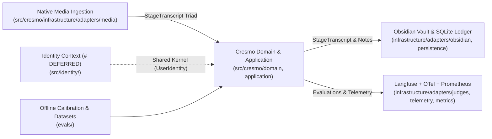

# Context Map — PES Knowledge Ecosystem

Conforms to: `ADR-001`, `ADR-004`, `ADR-018`, `ADR-057`, `ADR-062`.

## Bounded Contexts

1. **Cresmo Cognitive Synthesis (Core Domain)**
   - **Location**: `src/cresmo/` (`domain/`, `application/`, `infrastructure/`, `bootstrap/`, `presentation/`).
   - **Responsibility**: Native media ingestion, linguistic normalization (`fluid_prose`), Socratic epistemic densification (`gap_filler`), quality gates, OpenTelemetry + Langfuse observability, and Obsidian Second Brain persistence (`VaultRepositoryPort` / `SQLiteLedgerAdapter`).

2. **Identity & Access Management (Supporting Context — `# FUTURE / DEFERRED`)**
   - **Location**: `src/identity/` + `IamSettings` in `src/config.py`.
   - **Responsibility**: User registration, Argon2 password hashing, JWT issuance/validation, and Personal Access Tokens (PAT) awaiting API activation.

3. **Shared Kernel**
   - **Location**: `src/shared_kernel/` (`# FUTURE / DEFERRED` cross-context primitives).
   - **Responsibility**: Authenticated `UserIdentity` and minimal cross-context security abstractions shared between `identity` and `cresmo`.

4. **Evals & Calibration Harness (Supporting Tooling)**
   - **Location**: `evals/` + `src/cresmo/application/evals/`.
   - **Responsibility**: Offline judge calibration, generator benchmarking, Langfuse dataset publication, and JSON Golden Set SSOT (`evals/datasets/`).

5. **Research & Legacy Sandbox (Excluded / Untouched)**
   - **Location**: `playground/` (e.g., legacy `isb.ai/` experiments and local notes).
   - **Boundary Rule**: `src/` and `tests/` MUST NEVER import or execute modules from `playground/`. All historical runtime bridges were decommissioned per `ADR-004` in favor of native ingestion adapters.

