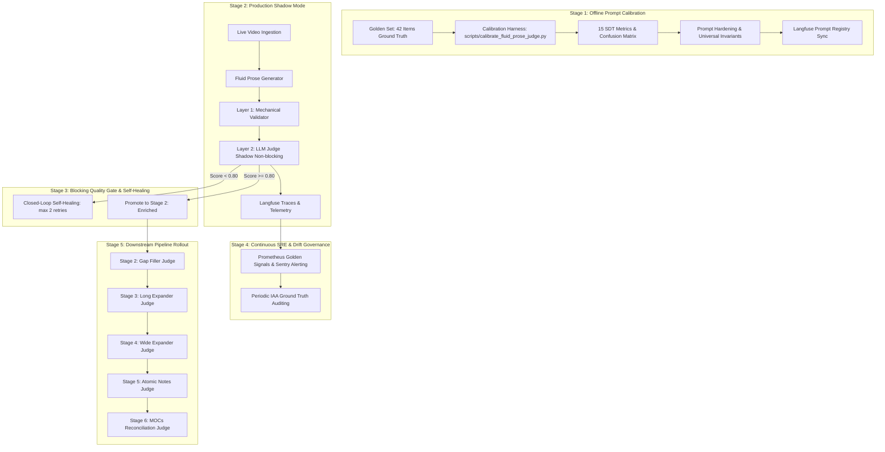

# ADR-039: Fluid Prose Canonical Judge Criteria, Two-Layered Mechanical Gates, and Progressive LLM-as-a-Judge Calibration Lifecycle

**Status:** ACCEPTED  
**Date:** 2026-10-11  
**Decision Makers:** Lead Architect (Fausto Stangler), Systems Architect (Doctor Stangler Committee)  
**Governing Method:** Doctor Stangler Architecture Method (Clean/Hexagonal DDD Modular Monolith, KISS & Fail-Fast Principles, ADR-First)  
**Glossary Reference:** [`docs/GLOSSARY.md`](../GLOSSARY.md)  
**Related ADRs:** [`ADR-001`](ADR-001-cresmo-modular-monolith-strangling.md), [`ADR-017`](ADR-017-langfuse-v4-prompt-management-and-anonymizer-governance.md), [`ADR-023`](ADR-023-prometheus-sre-golden-signals-and-dora-metrics-platform.md), [`ADR-028`](ADR-028-decoupling-fluid-prose-and-socratic-gap-filling.md), [`ADR-029`](ADR-029-unified-quality-judge-port-and-evaluator-adapters.md), [`ADR-030`](ADR-030-stage-quality-gate-and-evaluator-retry-fabric.md), [`ADR-031`](ADR-031-standardized-stage-descriptor-and-closed-loop-refinement.md), [`ADR-036`](ADR-036-clean-telemetry-namespacing-and-observation-binding.md)

---

## 1. Context & Architectural Motivation

In ADR-028, ADR-029, and ADR-031, the Cresmo ecosystem established the decoupled Stage 1 (`fluid_prose`), the polymorphic `LlmJudgePort` port, and the closed-loop self-healing retry fabric in `PipelineStageRunner`.

However, deploying an autonomous **LLM-as-a-Judge** into production without a mathematically validated calibration lifecycle exposes the knowledge synthesis engine to two fatal operational failure modes:
1. **Permissive Alpha Leakage ($\alpha$ - False Alarms / False Positives):** Approving corrupted, hallucinated, or oral-cluttered text. When extrinsic hallucinations or marketing CTAs pass Stage 1, they contaminate all downstream stages (`cresmo-gap-filler`, `cresmo-long-expander`, `cresmo-atomic`, and MOCs), permanently corrupting the Second Brain vault.
2. **Pedantic Beta Wastage ($\beta$ - Misses / False Negatives):** Excessive judge pedantry rejecting valid, faithful summaries. This causes endless loop retries, token exhaustion, and pipeline drops.

Furthermore, running raw prompt evaluations directly against LLM APIs without rate-limiting pacing triggers `429 RESOURCE_EXHAUSTED` quotas (e.g., Google GenAI Free Tier 15 RPM).

To solve this, we define the end-to-end configuration and deployment lifecycle for LLM judges, beginning with offline prompt calibration for `fluid_prose` and establishing the roadmap for all subsequent stages in the Cresmo pipeline.

---

## 2. Decision

We establish the **Canonical Fluid Prose Evaluation Framework** and the **Progressive 5-Stage LLM-as-a-Judge Lifecycle**.



---

### 2.1. Two-Layered Evaluation Topology

To maximize performance, minimize cost, and prevent LLM non-determinism on syntactic rules:

1. **Layer 1: Deterministic Mechanical Pre-flight Validator (Python Pure Function)**
   - Executes in $<0.1\text{ms}$ with zero API cost before any LLM judge invocation.
   - Enforces 7 deterministic syntactic invariants:
     * `Rule 1 (Heading Hierarchy)`: Document starts strictly with `## ` on Line 1.
     * `Rule 2 (Zero Frontmatter)`: Zero YAML frontmatter (`---`).
     * `Rule 3 (Zero Em-dashes)`: Text must contain zero em-dashes (`—`). Commas or periods must be used.
     * `Rule 4 (Zero Markdown Structures)`: Zero tables, bullets (`*`, `-`), numbered lists, LaTeX, or blockquotes (`>`).
     * `Rule 5 (Emphasis Invariant)`: Bold (`**...**`) strictly reserved for named entities and core concepts.
     * `Rule 6 (Authorial Invariant)`: Zero binary antitheses (`não X, mas Y`).
     * `Rule 7 (Paragraph Segmentation)`: Text exceeding 80 words must contain proper paragraph breaks (at least 2 paragraphs).

2. **Layer 2: Semantic LLM-as-a-Judge (`LlmJudgePort`)**
   - Evaluates 6 canonical semantic criteria with individual Hard Gates ($\ge 0.80$):
     * `ORALITY_REMOVAL`: Purges filler words, conversational noise, and colloquial stutter. **Hard Zero (0.0)** if any YouTube meta-speech (CTAs, likes, subscriptions, sales, sponsorships) remains.
     * `SEMANTIC_FAITHFULNESS`: 100% core thesis and argument retention; **Hard Zero (0.0)** for extrinsic facts not grounded in the source text, even if factually true in the real world.
     * `EPISTEMIC_CRITIQUE`: Validates legitimate in-line narrative framing of factual lapses or ideological bias without introducing hallucinations.
     * `NER_PRESERVATION`: Encyclopedic spelling correction of phonetically distorted proper names and dates. Regnal numerals and dates must match source precision.
     * `STRUCTURAL_COMPLIANCE`: Fluid continuous prose without lists or fragmented sentences, adhering to proper narrative spine and paragraph segmentation.
     * `AUTHORIAL_VOICE`: Detective narrator register, second-order causal mechanisms, methodological naturalism, and zero moralistic outrage.

---

### 2.2. The 5 Progressive Configuration Stages & Objective Metrics

Every judge in the Cresmo pipeline must advance through 5 discrete stages before running unmonitored in production.

#### Stage 1: Offline Prompt Calibration & Golden Set Hardening
- **Process:**
  1. Build a human-curated Golden Set of at least 40 items (balanced between PASS and FAIL across difficulty tiers: `easy`, `typical`, `borderline`).
  2. Execute `scripts/calibrate_fluid_prose_judge.py` to calculate the 15 Signal Detection Theory (SDT) metrics and confusion matrices.
  3. Identify failure modes (Permissive Alfa vs Pedantic Beta). Refine prompts universally (zero ad-hoc over-fitting).
  4. Synchronize versioned prompts to Langfuse via `cresmo seed-prompts`.
  5. Apply pacing delay ($4.2\text{s}$) and jitter ($0.8\text{s}$) with tenacity server-aware retry to respect API rate limits.
- **Stopping Criteria & Target Objectives:**

| Metric / Quality Gate | Formula / Reference | Target Threshold | Rationale |
| :--- | :--- | :--- | :--- |
| **Permissive Alfa Rate ($\alpha$ / FPR)** | $\frac{\text{Permissivo}}{\text{Rejeição} + \text{Permissivo}}$ | $\mathbf{\le 5.0\%}$ (0.00 on Critical Facts) | Zero tolerance for hallucination or leaked YouTube CTAs. |
| **Overall Accuracy** | $\frac{\text{Hit} + \text{Rejeição}}{\text{Total}}$ | $\mathbf{\ge 85.0\%}$ (Stretch: $\ge 90\%$) | Reliable baseline discrimination across all criteria. |
| **Precision / PPV** | $\frac{\text{Hit}}{\text{Hit} + \text{Permissivo}}$ | $\mathbf{\ge 88.0\%}$ | Approvals must be pure and faithfully grounded. |
| **Sensitivity / Recall** | $\frac{\text{Hit}}{\text{Hit} + \text{Pedantismo}}$ | $\mathbf{\ge 85.0\%}$ | Minimal false rejection of high-quality fluid prose. |
| **Signal Detection $d'$ (d-prime)** | $\Phi^{-1}(\text{Hit Rate}) - \Phi^{-1}(\text{FA Rate})$ | $\mathbf{\ge 2.00}$ | High cognitive separation between valid and defective prose. |
| **Decision Criterion $c$** | $-0.5 \cdot [\Phi^{-1}(\text{Hit Rate}) + \Phi^{-1}(\text{FA Rate})]$ | $\mathbf{0.00 \le c \le +0.30}$ | Neutral to slightly conservative/strict bias. |
| **$F_{0.5}$-Score** | $1.25 \cdot \frac{P \cdot R}{0.25P + R}$ | $\mathbf{\ge 0.85}$ | 2x heavier weight on Precision than Recall. |
| **Matthews Correlation (MCC)** | $\frac{(TP \cdot TN) - (FP \cdot FN)}{\sqrt{(TP+FP)(TP+FN)(TN+FP)(TN+FN)}}$ | $\mathbf{\ge 0.70}$ | Strong correlation across class distributions. |

---

#### Stage 2: Production Shadow Mode (Passive Observability)
- **Process:**
  - Run the judge in production alongside live video ingestion with `judge_blocking=False`.
  - The judge evaluates every generated prose artifact and logs telemetry to Langfuse, but does not abort the pipeline on failure.
- **Target Objectives:**

| Metric / Objective | Target Threshold | Rationale |
| :--- | :--- | :--- |
| **Langfuse Trace Coverage** | $100\%$ of all pipeline runs | Zero blind spots in production generation. |
| **Judge Latency ($P_{95}$)** | $\le 6.0\text{ seconds}$ | Protect ingestion throughput from blocking bottlenecks. |
| **Inference Cost per Evaluation** | $\le \$0.002$ | Sustainable batch processing economics. |
| **Discrepancy Drift Rate** | $\le 10\%$ unexpected failures | Baseline validation against real-world transcript diversity. |

---

#### Stage 3: Blocking Quality Gate & Closed-Loop Refinement
- **Process:**
  - Promote judge to `judge_blocking=True`.
  - On evaluation failure ($\text{Score} < 0.80$), `PipelineStageRunner` triggers closed-loop feedback refinement up to `max_retries=2`, injecting the judge's structured critique into the model context.
- **Target Objectives:**

| Metric / Objective | Target Threshold | Rationale |
| :--- | :--- | :--- |
| **First-Pass Yield (FPY)** | $\ge 80.0\%$ | 8 out of 10 transcript generations pass on the first attempt. |
| **Retry Recovery Rate** | $\ge 60.0\%$ | Over half of failed candidates self-heal within 2 retry attempts. |
| **Pipeline Hard Drop Rate** | $\le 5.0\%$ | Unrecoverable failures requiring human escalation remain minimal. |
| **Compendium Purity** | $100\%$ zero CTAs / zero em-dashes | Complete structural and semantic integrity in target directory. |

---

#### Stage 4: Continuous SRE & Observability Governance
- **Process:**
  - Prometheus Golden Signals monitor Latency, Traffic, Errors, and Saturation.
  - Sentry captures transient API failures.
  - Periodic human double-auditing against Langfuse traces to detect model degradation.
- **Target Objectives:**

| Metric / Objective | Target Threshold | Rationale |
| :--- | :--- | :--- |
| **Judge Error Rate (429 / 5xx)** | $\le 0.1\%$ | Tenacity backoff absorbs temporary provider throttling. |
| **Inter-Annotator Agreement (IAA)** | Cohen's $\kappa \ge 0.75$ | Agreement between LLM Judge verdicts and human architect audits. |
| **Prompt Drift Alerts** | Zero unversioned prompt updates | All prompts strictly governed via Langfuse and `prompts.json`. |

---

#### Stage 5: Downstream Pipeline Rollout Roadmap

Once Stage 1 (`fluid_prose`) satisfies all gates, the exact same 4-phase calibration methodology is replicated sequentially across the remaining 5 stages of the Cresmo pipeline:

```
[fluid_prose] (Stage 1 - Current)
     │
     ▼
[gap_filler] (Stage 2)
  ├── Canonical Criteria: Socratic 6 Epistemic Dimensions, Fact Checking, Causal Stratification.
  └── Target Gate: Accuracy >= 85%, Zero Unsupported Extrapolations.
     │
     ▼
[long_expander] (Stage 3)
  ├── Canonical Criteria: Braudel's Longue Durée, 3-Tier Causation, Plural Temporalities.
  └── Target Gate: Accuracy >= 85%, Zero Anachronistic Distortion.
     │
     ▼
[wide_expander] (Stage 4)
  ├── Canonical Criteria: Axial Time, Synchrony vs Parallelism, Comparative Systems.
  └── Target Gate: Accuracy >= 85%, Balanced Cross-Civilizational Framing.
     │
     ▼
[atomic_inventory & atomic_batch] (Stage 5)
  ├── Canonical Criteria: Semantic Atomicity, Single Concept Invariant, WikiLink Dual Linking.
  └── Target Gate: Accuracy >= 90%, Zero Orphaned Notes, Valid JSON schema.
     │
     ▼
[mocs_reconciliation] (Stage 6)
  ├── Canonical Criteria: Graph Centrality, Clustering Purity, Tag Taxonomy Governance.
  └── Target Gate: Accuracy >= 90%, 100% Index Reconciliation Consistency.
```

---

## 3. Rate-Limiting & Resilient Backoff Architecture

To prevent provider rate exhaustion (`429 RESOURCE_EXHAUSTED`), the infrastructure incorporates:
1. **Pacing Delay & Jitter:** `scripts/calibrate_fluid_prose_judge.py` defaults to `delay=4.2s` and `jitter=0.8s`. This caps throughput at $\sim 10\text{--}11\text{ RPM}$, safely below the 15 RPM free tier ceiling.
2. **Server-Aware Retry (`_wait_for_quota_or_backoff`):** `GeminiJudgeAdapter` inspects `retryDelay` payloads in Google GenAI API errors (`"Please retry in 47.8s"`). Tenacity pauses for the exact duration requested by the server plus jitter, preventing unneeded retries or premature fallback triggering.

---

## 4. Consequences

### Positive
- **Deterministic Quality Guarantees:** Zero corrupted transcripts enter the downstream Cresmo knowledge base.
- **Mathematical Transparency:** All prompt modifications are backed by 15 Signal Detection Theory metrics, eliminating subjective evaluation.
- **Self-Healing Pipeline:** Closed-loop retry recovery reduces manual intervention to $<5\%$.
- **Replicable Blueprint:** Establishes a standardized template for calibrating all upcoming stages (`gap_filler`, `long_expander`, `wide_expander`, `atomic_notes`, `mocs`).

### Negative / Trade-offs
- **Increased Ingestion Latency:** Closed-loop retries and pacing delay increase processing time per video transcript.
- **Prompt Maintenance Overhead:** Updating criteria requires synchronized changes to `prompts.json`, Langfuse registry, and the Golden Set.
