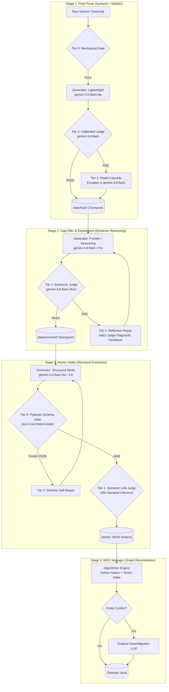

# ADR-045: Cognitive-Load-Tiered Pipeline, Heterogeneous Generator Architecture, and Evaluator Escalation

**Status:** PROPOSED  
**Date:** 2026-10-21  
**Decision Makers:** Lead Architect (Fausto Stangler), Systems Architect (Doctor Stangler Committee)  
**Governing Method:** Doctor Stangler Architecture Method (Clean/Hexagonal DDD Modular Monolith, KISS & Fail-Fast Principles, ADR-First)  
**Glossary Reference:** [`docs/GLOSSARY.md`](../GLOSSARY.md), [`CONTEXT.md`](../../CONTEXT.md)  
**Related ADRs:** [`ADR-001`](ADR-001-cresmo-modular-monolith-strangling.md), [`ADR-007`](ADR-007-pipeline-template-method-dry.md), [`ADR-011`](ADR-011-zero-hardcoded-tunables-and-unified-inference-observability.md), [`ADR-013`](ADR-013-iterative-llm-as-a-judge-indexing-loops.md), [`ADR-021`](ADR-021-unified-pipeline-execution-template-method-and-telemetry.md), [`ADR-028`](ADR-028-decoupling-fluid-prose-and-socratic-gap-filling.md), [`ADR-029`](ADR-029-unified-quality-judge-port-and-evaluator-adapters.md), [`ADR-030`](ADR-030-stage-quality-gate-and-evaluator-retry-fabric.md), [`ADR-031`](ADR-031-standardized-stage-descriptor-and-closed-loop-refinement.md), [`ADR-039`](ADR-039-fluid-prose-canonical-judge-criteria-and-mechanical-gates.md), [`ADR-041`](ADR-041-gemini-credential-pool-and-quota-failover.md)

---

## 1. Context & Architectural Motivation

In [ADR-028](ADR-028-decoupling-fluid-prose-and-socratic-gap-filling.md), [ADR-029](ADR-029-unified-quality-judge-port-and-evaluator-adapters.md), [ADR-030](ADR-030-stage-quality-gate-and-evaluator-retry-fabric.md), and [ADR-039](ADR-039-fluid-prose-canonical-judge-criteria-and-mechanical-gates.md), Cresmo established an isolated Quality Evaluation Subsystem governed by `LlmJudgePort` and closed-loop retry loops in `PipelineStageRunner`.

However, the current pipeline runtime operates under a **Homogeneous Model Assumption**: each pipeline stage and evaluation harness defaults to the single global model configured in `CresmoSettings.default_gemini_model`.

This homogeneous topology exhibits three major architectural vulnerabilities:

1. **The Cognitive Mismatch Anti-Pattern:**
   The cognitive requirements of the Cresmo pipeline stages vary across extreme orders of magnitude:
   - *Stage 1 (`fluid_prose`):* Primarily a **syntactic and stylistic transformation** (stripping conversational noise, hesitations, and oralities while preserving facts). Deploying frontier reasoning models here wastes computational budget and token quota.
   - *Stage 2 (`gap_filler` / `long_expander`):* Deep **epistemic and longitudinal causal reasoning** (Braudelian *longue durée*, multi-tier causation, counter-factual audit). Assigning an ultra-lightweight model here produces shallow prose, generic clichés, and hallucinations.
   - *Stage 3 (`cresmo_atomic`):* Strict **structural extraction and graph linkage** governed by JSON Schema.
   - *Stage 4 (`cresmo_moc_manager`):* Primarily **deterministic graph reconciliation**, entity resolution, and index traversal.

2. **The Evaluator Epistemic Asymmetry Principle:**
   In automated evaluation, **the Judge must possess equal or greater cognitive discriminative capability than the Generator**. If a lightweight model generates candidate text with subtle factual distortions or superficial logic, a judge of equivalent or lesser intelligence shares the exact same blind spots (yielding elevated False Acceptance rates, $\alpha$). Conversely, a smaller judge evaluating a sophisticated text often rejects valid prose due to sycophancy or surface-level length heuristics (elevated False Rejection rates, $\beta$).

3. **Blind Retries vs. Guided Escalation:**
   The current retry loop in `PipelineStageRunner` blindly repeats the invocation against the *same* generator with the *same* prompt. Stochastic variation rarely fixes systemic model inadequacies. When a lightweight generator fails evaluation criteria, the system should either **escalate to a superior model tier** (Model Cascading) or **inject the judge's diagnostic feedback** into a targeted repair prompt (Reflective Self-Correction).

---

## 2. Decision & Proposed Architecture

We propose the **Cognitive-Load-Tiered Pipeline Architecture**, establishing heterogeneous generator profiles, multi-layered quality gates, and stage-specific escalation policies.



---

## 3. Mathematical & Logistical Viability

The proposed architecture applies the principles of **FrugalGPT / Speculative Model Cascading**. The expected cost per synthesized document is formulated as:

$$E[\text{Cost}_{\text{stage}}] = C_{\text{tier0}} + C_{\text{gen\_base}} + C_{\text{judge}} + (1 - p_{\text{pass}}) \times (C_{\text{fallback}} + C_{\text{rejudge}})$$

Where:
- $C_{\text{tier0}} = \$0.00$ (Mechanical Python regex/Pydantic validation running in $<5\text{ms}$).
- $p_{\text{pass}}$ is the empirical first-pass acceptance rate (*Pass@1*) measured during benchmark calibration.
- $C_{\text{fallback}}$ represents either an escalated frontier inference or a targeted diff-repair prompt.

### Viability Threshold
* In **Stage 1 (`fluid_prose`)**, `gemini-3.5-flash-lite` achieves $p_{\text{pass}} \ge 0.80$ on orality removal. Running a lightweight generator with an escalated fallback yields a **~65% net token cost reduction** compared to running frontier models indiscriminately across all raw ingestions.
* In **Stage 2 (`gap_filler`)**, historical benchmarks show lightweight models achieve $p_{\text{pass}} < 0.45$ on deep historical causality (Annales school, 3-tier causality). Therefore, cascading from a cheap model is an anti-pattern (producing high latency and dual-inference costs in $>55\%$ of runs). **Stage 2 directly commissions the frontier generator** and relies on **Reflective Repair** rather than model substitution.

---

## 4. Stage-by-Stage Specification Matrix

| Stage | Cognitive Objective | Generator Tier | Primary Judge Tier | Fallback / Escalation Policy | Quality Gate Layers |
| :--- | :--- | :--- | :--- | :--- | :--- |
| **Stage 1: Fluid Prose** | Orality removal, punctuation, paragraph cohesion | **Lightweight** (`gemini-3.5-flash-lite`) | **Intermediate** (`gemini-3.8-flash`) | **Model Cascade** (Re-invoke with `gemini-3.8-flash`) | Layer 0 (Length ratio $>0.4$) $\to$ Layer 1 (Judge criteria) |
| **Stage 2: Gap Filler** | Socratic audit, epistemic depth, multi-tier causality | **Frontier** (`gemini-3.8-flash` / Pro) | **Frontier Strict** (`gemini-3.8-flash` CoT) | **Reflective Repair** (Re-prompt with failed criterion diagnostics) | Layer 0 (No markdown tables/lists) $\to$ Layer 1 (6 epistemic dimensions) |
| **Stage 3: Atomic Notes** | Fact extraction, note atomicity, WikiLink graph | **Structured** (`gemini-3.5-flash-lite` JSON Mode) | **Deterministic Pydantic** + Sampled Judge | **Schema Auto-Repair** (Feed Pydantic `ValidationError` back) | Layer 0 (Pydantic schema parse) $\to$ Layer 1 (Semantic link sample) |
| **Stage 4: MOCs** | Vault index reconciliation, tag governance | **Python Algorithmic** (Native script) | **Deterministic Graph** | **Surgical Disambiguation** (LLM invoked only on hash/title collision) | Layer 0 (Orphan link check, index uniqueness) |

---

## 5. Domain Modeling & Hexagonal Contracts (Proposed)

To realize this architecture cleanly within the Cresmo Hexagonal Domain, the following interfaces and value objects are proposed:

### 5.1. Domain Value Objects (`src/cresmo/domain/`)
```python
class GenerationTier(StrEnum):
    LIGHTWEIGHT = "lightweight"
    INTERMEDIATE = "intermediate"
    FRONTIER = "frontier"

class EscalationStrategy(StrEnum):
    MODEL_CASCADE = "model_cascade"
    REFLECTIVE_REPAIR = "reflective_repair"
    SCHEMA_REPAIR = "schema_repair"
    CIRCUIT_BREAK = "circuit_break"

@dataclass(frozen=True)
class ReflectiveRepairContext:
    original_input: str
    rejected_candidate: str
    failed_criteria: tuple[str, ...]
    judge_diagnostic_feedback: str
    attempt_index: int
```

### 5.2. Application Pipeline Integration (`src/cresmo/application/pipeline/`)
`PipelineStageRunner` will be extended with an `EscalationPolicy`:
- When `verdict.passed is False` and `attempt < max_attempts`:
  - If strategy is `MODEL_CASCADE`: re-bind generator adapter to `fallback_model` and execute.
  - If strategy is `REFLECTIVE_REPAIR`: invoke generator with `ReflectiveRepairContext`, instructing the model to repair specific identified deficiencies.
  - If strategy is `SCHEMA_REPAIR`: forward Pydantic exception details as system feedback.

---

## 6. Observability, Telemetry & SRE Golden Signals

This architecture embeds full observability into Prometheus, Grafana Loki, and OpenTelemetry / Langfuse:

1. **Prometheus Golden Signals:**
   - `cresmo_stage_escalation_total{stage, strategy, fallback_model}`: Counts model escalations and reflective repairs.
   - `cresmo_stage_first_pass_ratio{stage}`: Gauges generator effectiveness ($p_{\text{pass}}$).
   - `cresmo_stage_cost_dollars_total{stage, model_tier}`: Tracks FinOps expenditure per tier.
2. **Distributed Tracing (ADR-035 & ADR-037):**
   - When an escalation or reflective repair occurs, it is recorded as a nested child span linked to the parent work item trace:
     - `stage.fluid_prose.attempt_1` (Lightweight Generator) $\to$ `judge.evaluate` (FAIL)
     - `stage.fluid_prose.attempt_2` (Cascaded Frontier Generator) $\to$ `judge.evaluate` (PASS)

---

## 7. Consequences & Trade-offs

### Positive
- **Optimal FinOps Utilization:** Eliminates over-provisioned inference on simple tasks while securing maximum reasoning power for deep synthesis.
- **Epistemic Integrity:** Enforces the Evaluator Asymmetry Principle, guaranteeing that candidates are scrutinized by judges with superior discriminative capabilities.
- **Fail-Fast Efficiency:** Tier 0 mechanical and schema validations stop malformed outputs in milliseconds without expending LLM API calls.
- **Actionable Self-Correction:** Replaces blind retries with targeted diagnostic feedback, dramatically accelerating convergence on difficult texts.

### Negative / Trade-offs
- **Orchestration Complexity:** `PipelineStageRunner` must manage multi-model adapters, prompt rewriting for reflective repair, and distinct fallback strategies.
- **Dynamic Latency Variance:** While average batch latency drops due to lightweight generation on standard items, edge cases triggering escalations exhibit higher P99 latency ($T_{\text{light}} + T_{\text{judge}} + T_{\text{frontier}}$). Since Cresmo is an asynchronous batch pipeline, this trade-off is operationally benign.

---

## 8. Implementation Roadmap (Phased Migration)

1. **Phase 1: Architecture Approval & Config Hardening:** Lead Architect approves ADR-045. Centralize model tiers in `src/cresmo/infrastructure/config.py`.
2. **Phase 2: Tier 0 Mechanical Pre-Filters:** Implement zero-cost deterministic filters in `PipelineStageRunner` for Stage 1 and Stage 2.
3. **Phase 3: Stage 1 Model Cascading:** Implement `gemini-3.5-flash-lite` $\to$ `gemini-3.8-flash` cascading for `fluid_prose`.
4. **Phase 4: Stage 2 Reflective Repair:** Implement feedback-injected re-prompting for `gap_filler`.
5. **Phase 5: Stage 3 Pydantic Zero-Token Gate:** Implement schema auto-repair for `cresmo_atomic`.
